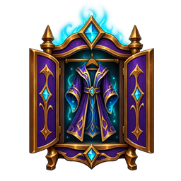

# Transmog ID

Transmog ID adds a small wardrobe icon to the default target frame when a
targeted player has a transmogrified appearance or weapon illusion.

It is made for WoW Forever and uses the game's inspection data. The icon
disappears when you target another unit, an NPC, or a player whose appearance
cannot be inspected.

This is a development verison of the addon and may not function as expected - check the readme for updates.

## Installation

The released version is available on CurseForge: https://www.curseforge.com/wow/addons/transmog-id

Alternatively:
1. Download or copy this project folder.
2. Rename the folder to `TransmogID` if it is not already named that.
3. Place it in your WoW Forever AddOns directory:

   `World of Warcraft/_forever_/Interface/AddOns/TransmogID`

4. Start the game and enable **Transmog ID** in the AddOns list on the
   character-selection screen.

## How to use it

Target a nearby player. If their displayed equipment includes a transmogged
appearance or weapon illusion, the wardrobe icon appears in the upper-right
area of the standard target frame.

Use `/tmid` to open the player-frame preview. Drag the wardrobe icon with the left mouse
button to position it, then scroll the mouse wheel over the icon to resize it in `0.1x`
steps from `1x` to `4x`. The window shows the current X and Y offsets and scale.
You can use the preview even when you have no target.

**Save settings** stores all three values and closes the menu.

**Cancel** restores the values from when the menu opened. Closing with `/tmid` also cancels.

**Reset to defaults** previews the default position and size; Save keeps them,
and Cancel undoes the reset.

## What the icon means

The icon means the inspected appearance does not match at least one item the
player has equipped, or that a weapon illusion is present.

It does **not** reveal the state of WoW Forever's personal “show transmogs”
toggle. That setting is not exposed to addons. A player with the toggle enabled
but no altered appearances will not show the icon.

## Troubleshooting

- **No icon for a player:** move closer and target them again. The game only
  supplies inspection data for eligible players in range.
- **No addon in the list:** check that `TransmogID.toc` is directly inside the
  `TransmogID` folder, alongside `transmogid.lua` and the `media` folder.
